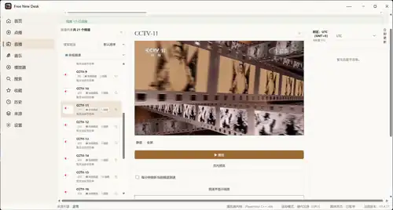
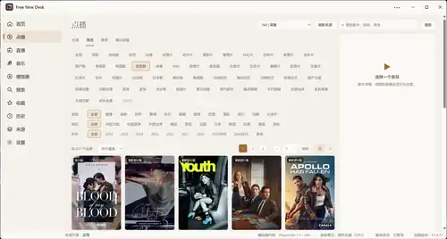
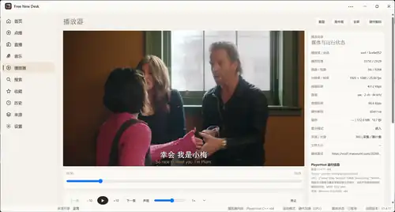
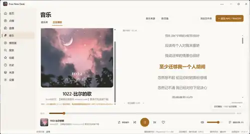

# Free New Desk

**在 Windows 桌面管理自己的点播、直播和音乐库。**

Free New Desk 是一款面向 **Windows 11 x64** 的 TVBox / FongMi 风格桌面影音播放器：导入你自有或已获授权的配置，集中浏览、搜索和播放；也可以直接从本地音乐文件夹开始，或连接 NAS 上的 SMB / WebDAV 音乐库。

**软件不内置、不推荐任何第三方影视源。** 首次打开没有影视内容，需要自行添加合法来源；体验本地音乐不需要影视配置。

**当前版本：V1.5.0** · [下载安装版](https://github.com/cwe88108/free-new-desk-public/releases/download/v1.5.0/Free-New-Desk-Setup-1.5.0-x64.exe) · [下载便携版](https://github.com/cwe88108/free-new-desk-public/releases/download/v1.5.0/Free-New-Desk-Portable-1.5.0-x64.exe) · [问题反馈](https://github.com/cwe88108/free-new-desk-public/issues)

TVBox/FongMi-style media player for Windows 11 x64, with local, SMB and WebDAV music libraries. No third-party video sources are included; bring your own authorized configuration.

## 先看看界面

以下是 **V1.4.17 打包应用的历史真实截图**，用于展示主要模块，**不代表 V1.5.0 的新布局，也不是本版验收证据**。

<table>
<tr>
<td width="50%"><br/><em>直播：频道、多线路与节目表</em></td>
<td width="50%"><br/><em>点播：分类、筛选、搜索与详情</em></td>
</tr>
<tr>
<td width="50%"><br/><em>播放器：原生播放与常用控制</em></td>
<td width="50%"><br/><em>音乐：音乐库、封面、歌词与队列</em></td>
</tr>
</table>

## 下载与安装

| 你想怎么用 | 下载 V1.5.0 |
| --- | --- |
| 正常安装，创建桌面与开始菜单快捷方式 | [Windows x64 安装版](https://github.com/cwe88108/free-new-desk-public/releases/download/v1.5.0/Free-New-Desk-Setup-1.5.0-x64.exe) |
| 不安装，直接运行；仍会保存应用数据 | [Windows x64 便携版](https://github.com/cwe88108/free-new-desk-public/releases/download/v1.5.0/Free-New-Desk-Portable-1.5.0-x64.exe) |
| 核对下载文件 | [SHA256 校验值](https://github.com/cwe88108/free-new-desk-public/releases/download/v1.5.0/SHA256SUMS-PUBLIC.txt) |
| 查看本次安装包对应的构建输入 | [源码快照](https://github.com/cwe88108/free-new-desk-public/releases/download/v1.5.0/Free-New-Desk-Source-1.5.0-public.zip) |

- **系统：** 主要开发与实测环境是 Windows 11 x64；Windows 10 x64 的完整兼容性尚未验证。
- **运行环境：** 发行包自带 libmpv，无需另装 VLC / FFmpeg；只有使用纯 JVM JAR 来源时才需另备 Java 17+。
- **签名：** 两个 Windows 程序均未进行发布者代码签名，不具有可信发布者签名。可用上方 SHA256 文件核对下载内容，校验值不等于发布者签名。
- **升级：** 先退出旧程序并备份本人数据。更多版本见 [全部发行](https://github.com/cwe88108/free-new-desk-public/releases)。

## 三步开始使用

1. **下载并打开。** 选择安装版或便携版。首次没有影视内容是正常状态。
2. **添加自己的内容，任选一种方式。**
   - **先体验音乐：** 在音乐模块添加本地音乐文件夹；已有网络音乐库也可添加 SMB / WebDAV。
   - **使用点播或直播：** 在「来源」页粘贴自有或已获授权的 TVBox / FongMi 配置 URL、`sites` / `lives` JSON，或选择本地配置文件；直播列表支持 M3U / TXT / JSON。
3. **选择内容播放。** 音乐库添加后选择曲目；影视配置导入后先查看来源兼容性明细和健康检查结果，再按需启用来源。涉及外部可执行代码时，先审核代码，再批准当前版本执行。

> [示例配置](examples/tvbox-sample.json) 仅说明格式，里面的 `example.invalid` 是无效占位地址，**不是可播放的演示源**。请替换为自己的合法接口；没有影视配置时，可先体验本地音乐。

配置默认保存在用户应用数据目录中的 `free-new-desk-public`。迁移请使用界面提供的导入功能。不要向公开 Issue 上传个人来源地址、账号凭据、令牌或诊断包。

## 能做什么

| 场景 | 功能 |
| --- | --- |
| **集中管理点播** | 分类、筛选、分页、详情、收藏、历史、剧集与线路；多来源并发搜索。 |
| **看直播和节目表** | M3U / TXT / JSON、IPTV 多线路、XMLTV / gzip EPG、频道收藏、最近节目与节目预约。 |
| **在桌面播放** | 独立 C++ PlayerHost + LGPL libmpv，原生视频窗口嵌入主窗口；硬件解码、字幕、音轨、倍速、比例、截图、全屏、画中画与播放队列。 |
| **整理自己的音乐** | 本地 / SMB / WebDAV 音乐库，曲目与艺人封面、手动封面、在线同步歌词、队列、进度记忆与 CUE 分段。 |
| **连接 NAS** | 原生 smb-helper 会话管理，共享目录连接、凭据冲突处理与错误提示。 |
| **检查和整理来源** | 来源分组、批量启停、健康检查、Source Audit 与 JSON 审计报告导出。 |
| **排查运行问题** | 分项缓存清理、日志目录、JVM / Plugin / libmpv 运行诊断与更新通道设置。 |

配置兼容覆盖 CMS XML / JSON、Type4、JS Spider、Drpy / Drpy2、XYQ、XBPQ，以及可选 JVM Spider / Plugin Host。**协议支持不等于每个来源都能播放**，实际结果取决于来源响应、执行环境和媒体兼容性；不承诺依赖 Android 环境的 JAR 完全兼容。

## 使用前需要知道

### 已知问题与验证范围

**V1.5.0 尚未修复：** 播放页向下滚动、视频区域部分离屏时，原生视频窗口可能越过页面顶部。

V1.5.0 的本地验证记录为：422 项单元／集成测试、21 项原生播放器检查通过；构建、类型、脱敏、发行载荷、更新配置和图标资源检查通过。**这些结果不代表所有外部来源、显卡和系统环境均已验收。** 完整跨窗口、硬解／多屏、安装升级及卸载矩阵仍需补齐，本次未重新进行完整人工界面验收。

详见 [V1.5.0 验证范围](docs/PUBLIC-V150-VALIDATION.md) 与 [发行说明](https://github.com/cwe88108/free-new-desk-public/releases/tag/v1.5.0)。V1.4.7 的 [V2 影视仓兼容状态](docs/compatibility-v2-status.md) 仅为历史记录，不作为本版证据。

### 安全与更新

- JS Spider、JAR Spider 与 Plugin 不进入 Renderer；渲染界面保持 `contextIsolation`、Sandbox 与 WebSecurity 隔离。
- 外部可执行来源默认不自动获得运行授权；代码或配置变化后应重新审核。进程隔离不能代替对来源代码的审核。
- 更新检查只匿名查询本仓库的 GitHub Releases，无需 GitHub 账号或令牌，不使用第三方配置提供的软件更新地址。
- 发现更新后打开发行页面，当前不提供静默下载安装；检查失败不会伪报“已是最新”，同版本号重新打包不会被识别为更高版本。
- 安全问题请按 [SECURITY.md](SECURITY.md) 报告，不要在公开 Issue 中提交凭据、私人来源地址、诊断包或可利用细节。

### 内容与责任

本软件是空壳播放器，只提供配置导入、解析、直播、节目表和播放能力，不内置第三方影视源。请仅导入本人自有或已获授权的配置与内容，并自行承担合法合规责任。

开发者不提供、推荐、背书或担保任何第三方来源，其可用性、内容和使用条件由来源提供者决定。软件按**“原样”**提供，不提供任何明示或暗示担保；兼容性与测试通过情况不构成内容或服务保证。

## 更新记录

V1.5.0 调整了首页和播放器布局，改进来源导入后的即时刷新，并修复直播播放列表跳转误报失败等问题。

[查看 V1.5.0 完整发行说明](https://github.com/cwe88108/free-new-desk-public/releases/tag/v1.5.0) · [查看历史版本](https://github.com/cwe88108/free-new-desk-public/releases)

## 开发与构建

需要 Windows x64、Node.js >=24.18.1、JDK 17、CMake 与 Visual Studio C++ Build Tools。使用源码前请先阅读下方许可说明。

```powershell
npm ci
npm run verify
npm run package:win
```

构建产物位于 `dist/releases`。更多步骤见 [开发说明](docs/README-dev.md)（其中部分版本介绍为历史内容）。发行源码快照对应安装包的构建输入，主线另含后续文档与历史截图更新；构建来源的清单与核对说明见 [V1.5.0 Release](https://github.com/cwe88108/free-new-desk-public/releases/tag/v1.5.0)。

## 第三方与许可

感谢 TVBox / FongMi / 猫影视的接口与配置格式生态，以及 Electron、libmpv、Vue、TypeScript、Vite 等组件与工具。第三方组件、各自许可证及 libmpv 构建来源见 [THIRD_PARTY_NOTICES.md](THIRD_PARTY_NOTICES.md)。致谢不表示推荐或担保任何第三方影视源。

**本项目为源码可见（source-available）项目，并非采用开放源代码许可证的项目。** 根据 [LICENSE](LICENSE)，公开源码不授予一般性的再分发、修改、再许可或商业使用授权；这些用途需要版权所有者的明确许可。第三方组件遵循各自许可证。

## 反馈

遇到问题或有功能建议，请到 [Issues](https://github.com/cwe88108/free-new-desk-public/issues)，说明软件版本、系统版本和复现步骤，提交前移除个人来源地址与敏感信息。

如果 Free New Desk 对你有用，欢迎点个 Star，方便以后再找到它。
